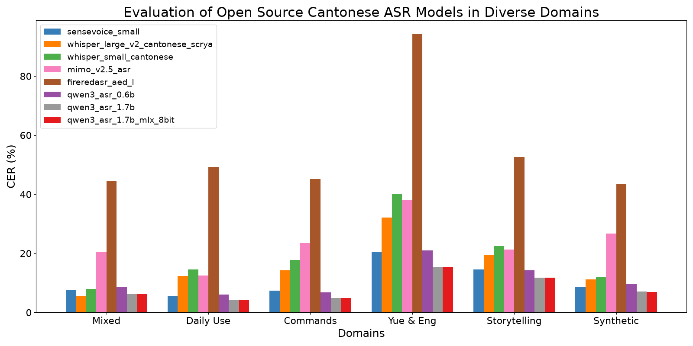

# Evaluation of Open Source Cantonese ASR Models in Diverse Domains


| Dataset      | sensevoice_small CER | whisper_large_v2_cantonese_scrya CER | whisper_small_cantonese CER | mimo_v2.5_asr CER | fireredasr_aed_l CER | qwen3_asr_0.6b CER | qwen3_asr_1.7b CER | qwen3_asr_1.7b_mlx_8bit CER |
|--------------|----------------------|--------------------------------------|-----------------------------|-------------------|----------------------|--------------------|--------------------|-----------------------------|
| Mixed        | 7.70%                | 5.55%                                | 8.00%                       | 20.53%            | 44.49%               | 8.70%              | 6.21%              | 6.27%                       |
| Daily Use    | 5.64%                | 12.38%                               | 14.60%                      | 12.50%            | 49.27%               | 6.12%              | 4.22%              | 4.13%                       |
| Commands     | 7.45%                | 14.22%                               | 17.83%                      | 23.52%            | 45.21%               | 6.83%              | 4.89%              | 4.85%                       |
| Yue & Eng    | 20.49%               | 32.14%                               | 40.06%                      | 38.20%            | 94.14%               | 20.93%             | 15.38%             | 15.44%                      |
| Storytelling | 14.52%               | 19.47%                               | 22.48%                      | 21.28%            | 52.61%               | 14.31%             | 11.79%             | 11.79%                      |
| Synthetic    | 8.51%                | 11.22%                               | 11.90%                      | 26.72%            | 43.61%               | 9.66%              | 7.04%              | 6.93%                       |

Every cell above, and the chart, comes from one run of `eval.py` over the committed
`results/`, with the versions pinned in `environment.yml` (opencc 1.1.8, jiwer
3.0.4). The SenseVoice and Whisper cells for Yue & Eng, Storytelling and
Synthetic were refreshed: those results were regenerated in June 2025 and the
chart with them, but the table still carried the 2024 values. The `expected`
texts are identical across models, so the reference data did not change. The
chart shows the same eight columns as the table; the `language=None` run is
compared separately under Discussion.

## Open Source ASR Models
1. [SenseVoiceSmall](https://huggingface.co/FunAudioLLM/SenseVoiceSmall): Trained on 300,000 hours of multilingual speech, including almost 9600 hours of Cantonese speech, Alibaba's multilingual model shows state-of-the-art ASR capability in Chinese, English, Cantonese, Japanese, and Korean. Extremely low inference latency was achieved by employing a non-autoregressive end-to-end architecture.
2. [Scrya/whisper-large-v2-cantonese](https://huggingface.co/Scrya/whisper-large-v2-cantonese): This model is a fine-tuned version of openai/whisper-large-v2 on the mozilla-foundation/common_voice_11_0 dataset. It achieves a CER of 6.2133 on the evaluation set of Common Voice 11.
3. [alvanlii/whisper-small-cantonese](https://huggingface.co/alvanlii/whisper-small-cantonese): This model is a fine-tuned version of openai/whisper-small on the Cantonese language. It achieves a 7.93 CER (without punctuations), 9.72 CER (with punctuations) on Common Voice 16.0. In total, 934 hours of Cantonese speech are used for fine-tuning, with 138 hours from Common Voice 16.0 zh-HK Train, 85 hours from Common Voice 16.0 yue Train, 178 hours from Common Voice 17.0 yue Train, and 72 hours from Cantonese-ASR, 23 hours from CantoMap, and lastly 438 hours from Pseudo-Labelled YouTube videos.
4. [XiaomiMiMo/MiMo-V2.5-ASR](https://huggingface.co/XiaomiMiMo/MiMo-V2.5-ASR): Xiaomi's audio-language model for ASR. It encodes audio via a custom audio tokenizer into discrete tokens that are fed into a language model, supporting Chinese and English with automatic language detection.
5. [FireRedTeam/FireRedASR-AED-L](https://huggingface.co/fireredteam/FireRedASR-AED-L): A 1.1B-parameter attention encoder-decoder (AED) model from FireRed Team. It supports audio up to 60 seconds and is optimised for Mandarin and mixed-language speech.
6. [Qwen/Qwen3-ASR-0.6B](https://huggingface.co/Qwen/Qwen3-ASR-0.6B): A 0.6B-parameter multilingual ASR model from Alibaba's Qwen team, supporting 30 languages and 22 Chinese dialects including Cantonese. Uses a transformer-based architecture with bfloat16 inference.
7. [Qwen/Qwen3-ASR-1.7B](https://huggingface.co/Qwen/Qwen3-ASR-1.7B): The 1.7B-parameter variant of Qwen3-ASR with the same multilingual capabilities as the 0.6B model but larger capacity.
8. **Qwen3-ASR-1.7B (MLX, 8-bit)**: the same 1.7B checkpoint run on Apple Silicon through [MLX](https://github.com/ml-explore/mlx) via [`mlx-qwen3-asr`](https://pypi.org/project/mlx-qwen3-asr/), with the weights quantised to 8 bits at load time (`quantize_model`, group_size 64) rather than run at bfloat16. Reported as its own row so the quantisation loss stays visible rather than assumed. Decoded with `language="Cantonese"` to match the bfloat16 row; a second run with `language=None` is in `results/qwen3_asr_1.7b_mlx_8bit_auto/` and discussed below. Measured on an M5 Pro: 8 h 21 min of audio in 25 min wall-clock, RTF 0.040-0.056.

## Datasets from Various Domains
1. **[Mixed]** [Common Voice 17.0](https://huggingface.co/datasets/mozilla-foundation/common_voice_17_0): Common Voice is a publicly available voice dataset, powered by the voices of volunteer contributors around the world. As of version 17.0, there are 178 hours of Cantonese audio under the yue language tag.
2. **[Daily Use]** [Guangzhou Daily Use](https://huggingface.co/datasets/AlienKevin/guangzhou-daily-use-speech): 4.06 hours of transcribed Guangzhou Cantonese scripted speech focusing on daily use sentences, where 4,060 utterances contributed by ten speakers were contained.
3. **[Commands]** [Guangzhou Cabin](https://huggingface.co/datasets/AlienKevin/guangzhou-cabin-speech): 5 hours of transcribed Guangzhou Cantonese scripted speech in the vehicle focusing on digits, commands and queries, where 6,219 utterances contributed by ten speakers were contained.
4. **[Yue & Eng]** [Mixed Cantonese and English](https://huggingface.co/datasets/AlienKevin/mixed_cantonese_and_english_speech): 34.8 hours of mixed Cantonese and English audio spanning 18 topics related to daily life. The corresponding annotated text consists of 307,540 Chinese characters and 70,132 English words. Among the topics, the "Food" category has the highest frequency of English words, with a Chinese character to English word ratio of approximately 3:1. On the other hand, the "Tech News" topic has the lowest frequency of English words, approximately 8:1.
5. **[Storytelling]** [Zoeng Jyutgaai's Romance of the Three Kingdomgs](https://huggingface.co/datasets/laubonghaudoi/zoengjyutgaai_saamgwokjinji): 1,402 utterances by Cantonese storyteller Zoeng Jyutgaai (張悦楷) on the classical work "Romance of the three kingdoms".
6. **[Synthetic]** [words.hk sentences generated with AWS Polly](https://huggingface.co/datasets/AlienKevin/wordshk_cantonese_speech): 115K utterances generated with AWS Polly's Cantnoese voice Hiujin. Sentences are sourced from the the definitions and examples of the words.hk dictionary.

## Discussion

1. Among the three models in the original comparison (SenseVoice Small and the two Whisper models), SenseVoice Small leads in all domains except the mixed domain. The two Whisper models are fine-tuned on subsets of the Common Voice 17.0 dataset. Impressively, SenseVoice Small still outperforms Whisper Small Cantonese on CV 17 Test. Of the models added since, Qwen3-ASR-1.7B now has the lowest CER overall (point 5).
2. The Whisper models struggle the most on the Cantonese-English code switching domain, which can be explained by the lack of code switching sentences in the Common Voice dataset they are fine-tuend on.
3. The second most difficult domain is the storytelling domain. It is challenging because the story used in evaluation, Romance of the Three Kingdoms, contains many historical names and places, which are rarely seen in the training data.
4. Overall, SenseVoice shows remarkable generalization capability across various domains while Whisper models suffer significant precision loss on domains that are not fine-tuned on. This shows that more diverse training data needs to be curated for developing more robust Whisper models.
5. Qwen3-ASR-1.7B (at either precision) has the lowest CER in five of the six domains, losing only Mixed to Whisper Large v2, which is fine-tuned on Common Voice itself. Its largest absolute margin is on Cantonese-English code-switching: 15.38% against 20.49% for SenseVoice Small, the next best model outside the Qwen family.
6. **8-bit quantisation of Qwen3-ASR-1.7B is close to free on these domains.** With the language forced on both sides, the mean signed difference against bfloat16 is -0.02 pp and the mean absolute difference is 0.06 pp; no domain moves by more than 0.12 pp. Three domains are slightly better quantised, two slightly worse and one unchanged, which is what noise looks like rather than a systematic loss. One caveat: the MLX row differs from the bfloat16 row in more than the weights. Its audio went through a 16-bit WAV file, any audio not already at 16 kHz was resampled with `scipy.signal.resample_poly` rather than torchaudio, and the unquantised parts ran at float16 rather than bfloat16. So these figures are the combined effect of all of these, not of quantisation alone.
7. **Forcing the language costs nothing in accuracy, but it does save time.** Comparing the two MLX runs (`language="Cantonese"` vs `language=None`, same weights): mean absolute difference 0.03 pp, largest single move 0.12 pp on Mixed. Even on the code-switching set the two agree to 0.02 pp. Language detection is, however, not free in wall-clock: 25 min versus 32 min for the same 6,933 utterances, so about a 30% decode-time saving from forcing it. Caveat worth stating: every utterance here is a full sentence. This says nothing about sub-second audio, where language detection has much less to go on.

| Dataset | `language="Cantonese"` | `language=None` |
|---|---|---|
| Mixed | 6.27% | 6.39% |
| Daily Use | 4.13% | 4.14% |
| Commands | 4.85% | 4.85% |
| Yue & Eng | 15.44% | 15.46% |
| Storytelling | 11.79% | 11.79% |
| Synthetic | 6.93% | 6.88% |

## Filtering and Postprocessing

### Filtering
1. All utterances from the test set of Common Voice 17.0 are kept.
2. The first 1,000 utterances are chosen for evaluation for each of the other datasets.

### Postprocessing
1. Convert all Chinese characters to simplified.
2. Strip away all punctuations and spaces.
3. Remove any emotion or event tags (sensevoice only).

## Reproduction

### Environment

Clone this repo with submodules to include FireRedASR and MiMo-V2.5-ASR:
```bash
git clone --recurse-submodules https://github.com/hon9kon9ize/cantonese_asr_eval.git
# or, if already cloned:
git submodule update --init --recursive
```

Install Python dependencies:
```bash
pip install funasr transformers torch torchaudio datasets librosa matplotlib tqdm evaluate jiwer opencc qwen-asr
# Install flash-attn pre-built wheel matching your torch + CUDA version:
# https://github.com/mjun0812/flash-attention-prebuild-wheels/releases
pip install "https://github.com/mjun0812/flash-attention-prebuild-wheels/releases/download/v0.9.0/flash_attn-2.8.3%2Bcu128torch2.9-cp311-cp311-linux_x86_64.whl"
pip install -r FireRedASR/requirements.txt
pip install -r MiMo-V2.5-ASR/requirements.txt
# Apple Silicon only, for the qwen3_asr_1.7b_mlx_8bit rows; skip on Linux:
pip install mlx-qwen3-asr
```

Download model weights:
```bash
# FireRedASR-AED-L
huggingface-cli download fireredteam/FireRedASR-AED-L --local-dir ./pretrained_models/FireRedASR-AED-L

# MiMo-V2.5-ASR
huggingface-cli download XiaomiMiMo/MiMo-V2.5-ASR --local-dir ./models/MiMo-V2.5-ASR
huggingface-cli download XiaomiMiMo/MiMo-Audio-Tokenizer --local-dir ./models/MiMo-Audio-Tokenizer
```

See the `environment.yml` for a reference conda environment on macOS.

### Evaluate
```
python run.py
```

Generated outputs of all the models can be found under the `results/` folder.

Then, you can calculate the character error rate for the results using:
```
python eval.py
```

`eval.py` also writes `cer_chart.png`. The chart above was generated with the
table's eight columns, in table order:
```
python eval.py --model sensevoice_small whisper_large_v2_cantonese_scrya whisper_small_cantonese mimo_v2.5_asr fireredasr_aed_l qwen3_asr_0.6b qwen3_asr_1.7b qwen3_asr_1.7b_mlx_8bit
```
